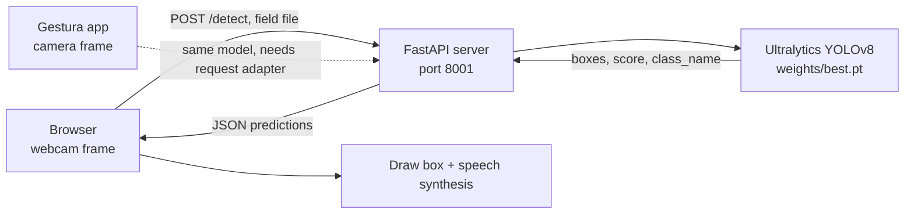
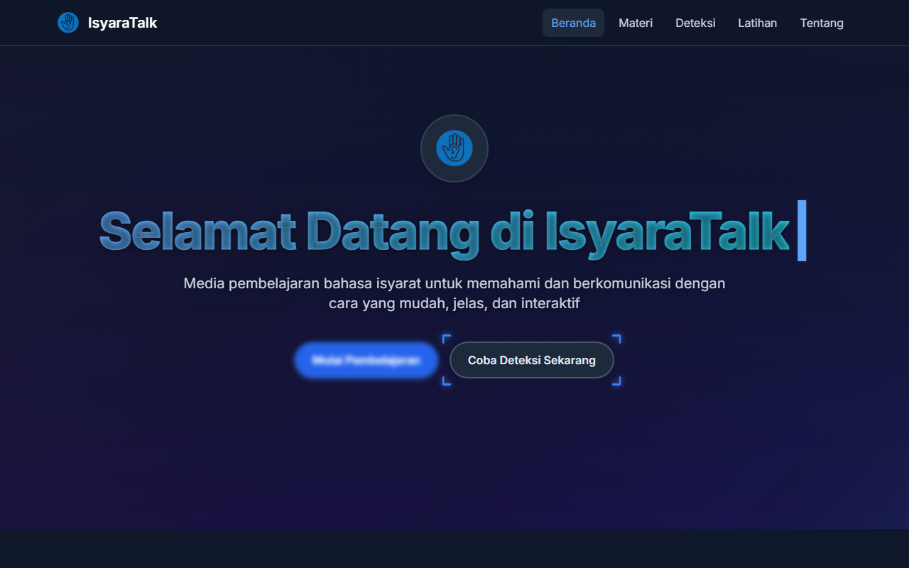
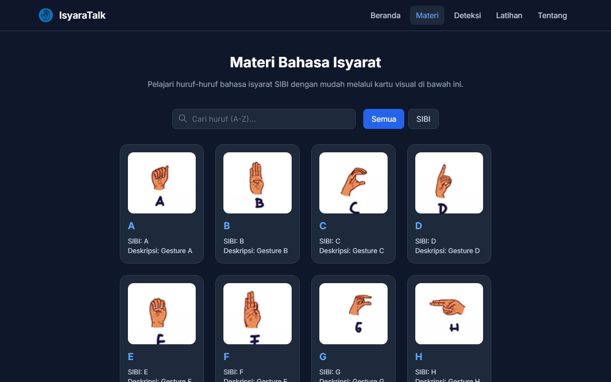
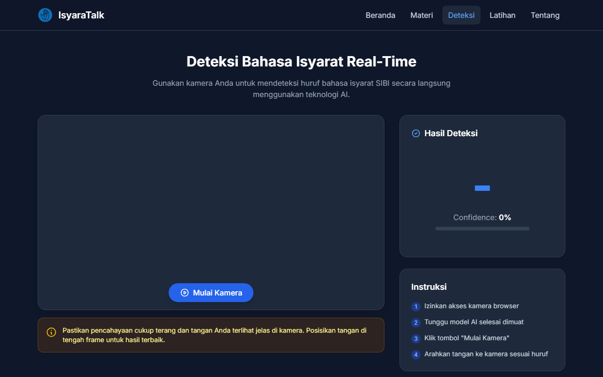

<h1 align="center">IsyaraTalk</h1>
<p align="center">A web client for learning SIBI sign language with a live camera page, plus the YOLOv8 detection API that also serves the Gestura mobile app.</p>
<p align="center">


</p>

## Overview

Learning sign language from static material gives no feedback on whether a hand shape is right. IsyaraTalk is a static web client (HTML, vanilla JS, Tailwind via CDN) with lesson cards, a quiz and a live camera page. The camera page sends frames to a small FastAPI server that runs a YOLOv8 model trained on the 26 SIBI alphabet letters. The same server is the detection backend for the Gestura Android app.

## Features

- Detection API with `GET /health` and `POST /detect` (multipart image, returns boxes, scores and class names); built on FastAPI and Ultralytics.
- Live camera page: grabs webcam frames, posts them to the API, draws the result and speaks the letter with the browser speech synthesis (`id-ID`).
- Optional MediaPipe Hands pre-check in the browser (loaded from CDN) before a frame is sent.
- Material page: A to Z SIBI cards with search.
- Practice page ("Latihan") with a level-based quiz using sign images.
- Training script for YOLOv8 and a webcam demo that runs the weights locally.
- Bundled `best.pt` (6 MB, YOLOv8n-sized, 29 classes: `0`, `A` to `Z`, `bukan tangan`, `tangan lain`).

## How it works



Response shape: `{ "predictions": [ { "box": {x1, y1, x2, y2, w, h}, "score", "class_id", "class_name" } ] }`, in pixels of the uploaded image, confidence threshold 0.15. The web page finds the server at `http://<page host>:8001`; if it is unreachable the page falls back to a TF.js model (not included) or a simulated mode.

## Screenshots

| | |
|---|---|
|  |  |
| Home | Material (SIBI cards) |
|  | |
| Live detection page, API connected | |

## Getting started

Prerequisites: Python 3.10+, a webcam, a modern browser. Verified: the API loads `weights/best.pt`, answers `/health` and returns a prediction for a test image. The live webcam flow in a browser was not run end to end.

```bash
# 1. detection API
cd api
python -m venv .venv && source .venv/bin/activate   # Windows: .venv\Scripts\activate
pip install -r requirements.txt
uvicorn app:app --host 127.0.0.1 --port 8001
# optional: MODEL_PATH=/path/to/best.pt to use other weights

# 2. web client (second terminal)
cd web
python -m http.server 8000
# open http://localhost:8000/detection.html
```

The home-page background video (`js/Image/bluebg.mp4`) is not included, so the page shows the poster image instead.

Retraining (optional): download the SIBI alphabet dataset in YOLOv8 format from Roboflow (project `sibiii-f2tcz`, version 10, CC BY 4.0, https://universe.roboflow.com/ujangtiri/sibiii-f2tcz) into `training/dataset/`, then run `python training/train_model.py`. That script trains `yolov8s` for 20 epochs. The bundled `best.pt` comes from a separate run (YOLOv8n-sized, 50 epochs per the checkpoint); its training script was not kept. The dataset is not redistributed here.

## Project context

IsyaraTalk was the web client of the Intelligent Systems and Automation course at UPI Kampus Cibiru (2025). The same detection API serves the Gestura mobile app (Mobile Application Programming course, team of six with Deden Pradeka as lecturer). My role: the model, the API and the clients.

## Limitations

- No accuracy figure is claimed. Training metrics were not kept, so the model was only checked by hand.
- Camera-to-API behaviour in the browser and the Gestura client were not re-tested after packaging. Gestura's request shape (`/api/detect`, field `image`, `results`) differs from this API, so an adapter is needed.
- The API has no authentication and allows any CORS origin; it is meant for local use.
- The SIBI illustrations in `web/js/Image` are course material of unconfirmed origin; replace them if you reuse the project.
- The dataset covers static letters only (no words or motion).

## License

MIT, see [LICENSE](LICENSE). Third-party: Ultralytics (AGPL-3.0), Tailwind, GSAP, TensorFlow.js, MediaPipe (CDN-loaded), and the CC BY 4.0 dataset linked above.
